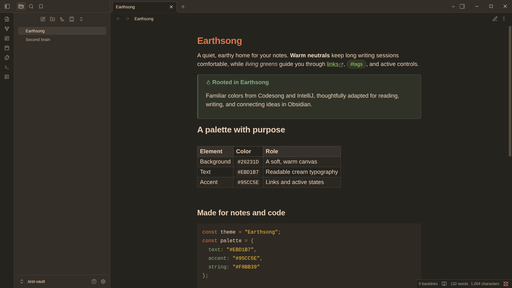

# Earthsong

A warm, dark theme for Obsidian with earthy brown surfaces, cream text and green accents.

## Features

- Low-contrast brown interface with readable cream text.
- Green links, active states, tags, and navigation highlights.
- Earthsong syntax highlighting in editing and reading modes.
- Styled headings, blockquotes, callouts, tables, code blocks, graph, and Canvas.
- Desktop and mobile support, with no remote fonts, images, or other network resources.
- One dark palette for both Obsidian base color scheme settings.

## Installation

### Community themes

Open **Settings → Appearance → Themes → Manage**, search for **Earthsong**, and select **Install and use**.

### Manual installation

1. Download `theme.css` and `manifest.json` from the latest release.
2. Create an `Earthsong` folder inside your vault's `.obsidian/themes/` directory.
3. Place both files in that folder.
4. In Obsidian, open **Settings → Appearance → Themes** and select **Earthsong**.

For local development, clone this repository into `.obsidian/themes/Earthsong` inside a vault.

## License

[MIT](LICENSE)

## References

- [Dayle Rees — Earthsong](https://github.com/daylerees/colour-schemes/blob/master/vscode/daylerees.theme.earthsong/earthsong.json): original editor and syntax color scheme.
- [Connor Peet — Codesong](https://github.com/connor4312/codesong): editor and syntax palette.
- [Gabriel Nakic — Earthsong IntelliJ](https://github.com/gnakic/earthsong-intellij-theme): interface neutrals and selection colors.
- [Earthsong for Telegram](https://github.com/urfv/earthsong-telegram): adapted application palette.
